# Parallel Matrix Inversion Using Gauss–Jordan Elimination

A C++ project comparing sequential and parallel implementations of the Gauss–Jordan matrix inversion algorithm using **POSIX Threads (Pthreads)**, **OpenMP**, and **MPI**. We benchmarked all four implementations on a computing cluster and analyzed execution time, scalability, synchronization costs, and communication overhead.

## Project Overview

Gauss–Jordan elimination computes a matrix inverse by transforming an augmented matrix `[A | I]` into `[I | A⁻¹]`. For each column, the algorithm selects a pivot, normalizes the pivot row, and eliminates that column's other entries. The sequential implementation serves as the baseline for the parallel versions and has **O(n³)** time complexity.

The matrix generators create invertible, diagonally dominant matrices in three forms:

- Random diagonally dominant matrices
- Diagonally dominant tridiagonal matrices
- Diagonally dominant sparse (*k*-sparse) matrices

The implementations parallelize row-elimination operations: apart from the pivot row and required synchronization, updates to different rows can be performed independently.

## Implementations

| Version | Parallelization strategy |
| --- | --- |
| **Sequential** | Single-threaded Gauss–Jordan elimination; baseline implementation |
| **Pthreads** | Worker threads are created once to reduce startup overhead; `pthread_barrier_t` synchronizes pivoting and elimination stages |
| **OpenMP** | `#pragma omp parallel for` distributes row-elimination loops using a fork–join execution model |
| **MPI** | Matrix rows are distributed among processes, and the pivot row is shared using `MPI_Bcast` |

Input/output, validation, and testing logic were separated into `helpers.h` and `helpers.cpp` to support comparison between implementations. The project also includes a `Makefile` with build and clean rules.

## Testing and Performance Profiling

We verified each parallel implementation against the sequential results and tested the algorithms on a computing cluster using `sbatch`.

- **Matrix dimensions:** 300×300, 500×500, 600×600, 700×700, and 800×800
- **Parallel configurations:** 4, 8, and 16 cores/processes
- **Profiling tool:** Intel VTune
- **Automation:** Per-implementation `profile.sh` scripts for cluster execution and an additional script to process the full input dataset
- **Test-data generation:** `generate_mat.py` for generating matrices of configurable size

Each implementation was organized into its own directory, and the Makefile was adjusted for compilation on the cluster. In our testing, matrices larger than approximately 300×300 were needed for useful VTune analysis.

## Performance Results

### VTune profiles — 800×800 matrix

The following profiles compare the sequential algorithm with Pthreads, OpenMP, and MPI at different levels of parallelism.

#### Sequential

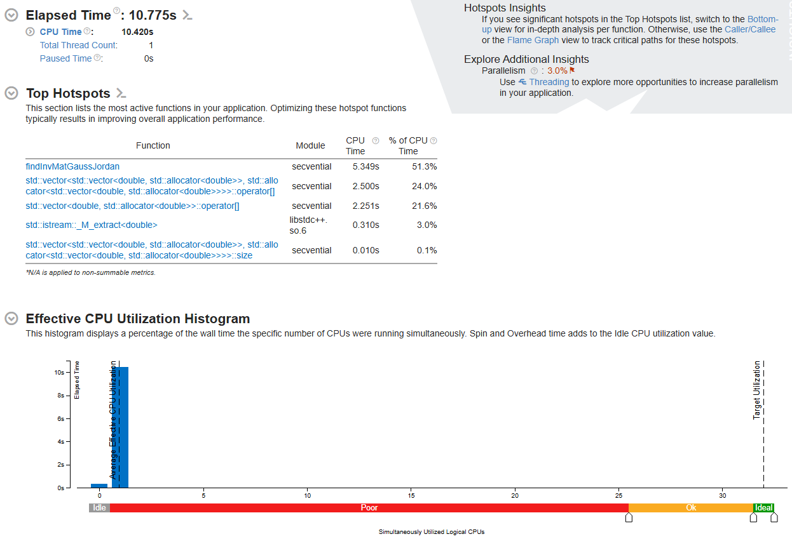
*Figure 1. Sequential VTune profile.*

#### Pthreads

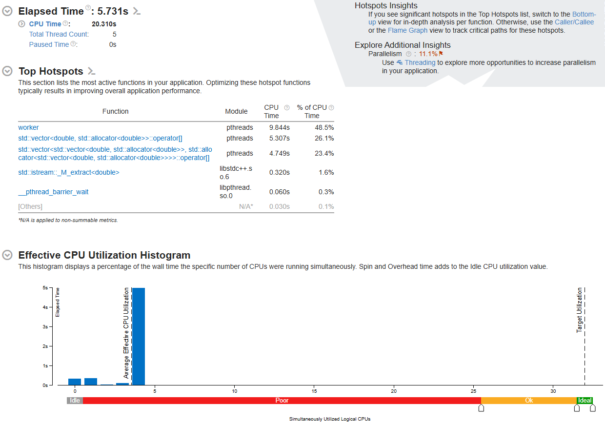
*Figure 2. Pthreads VTune profile, 4 cores.*

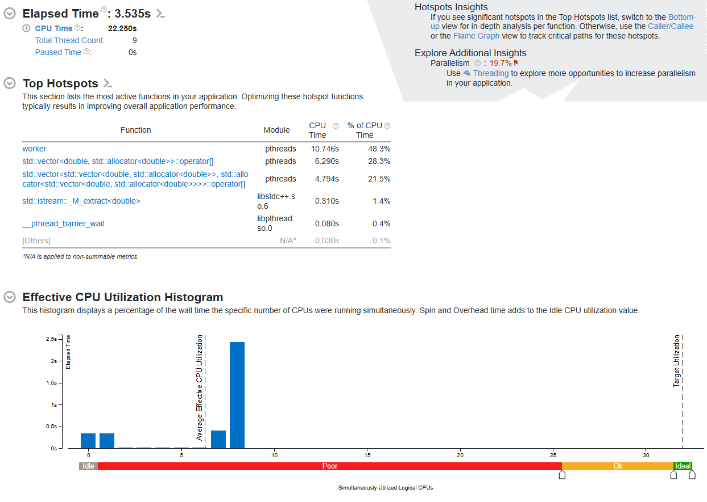
*Figure 3. Pthreads VTune profile, 8 cores.*

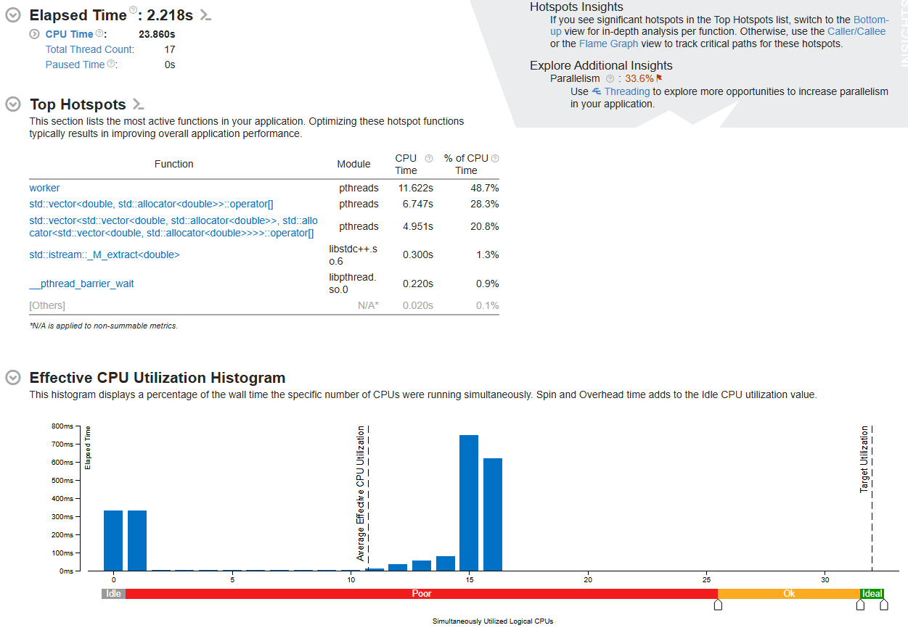
*Figure 4. Pthreads VTune profile, 16 cores.*

#### OpenMP

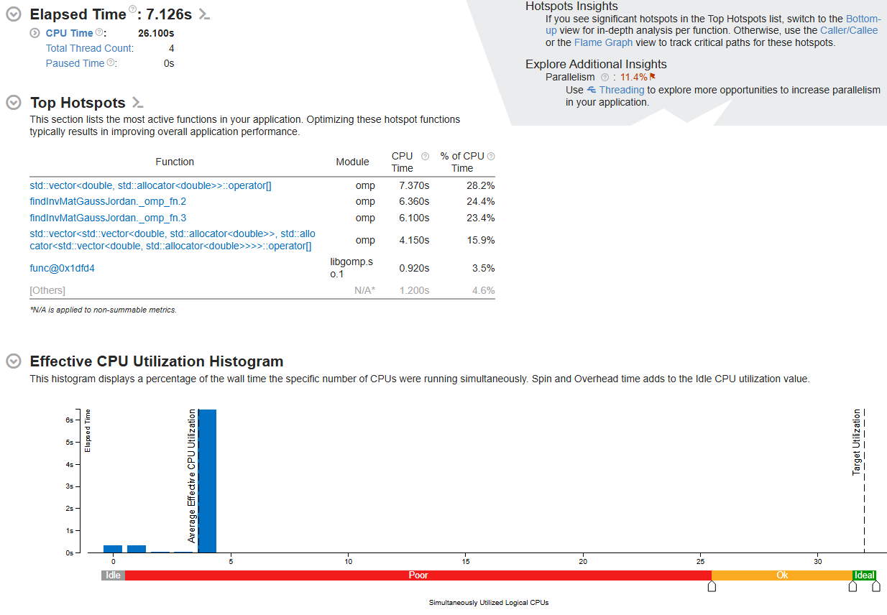
*Figure 5. OpenMP VTune profile, 4 cores.*

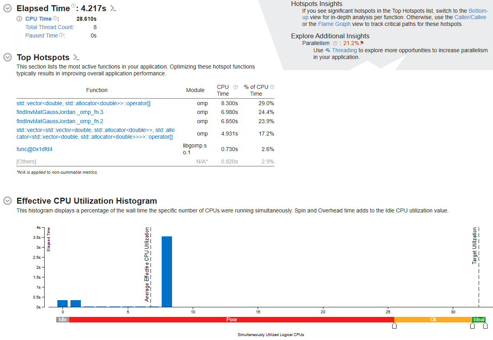
*Figure 6. OpenMP VTune profile, 8 cores.*

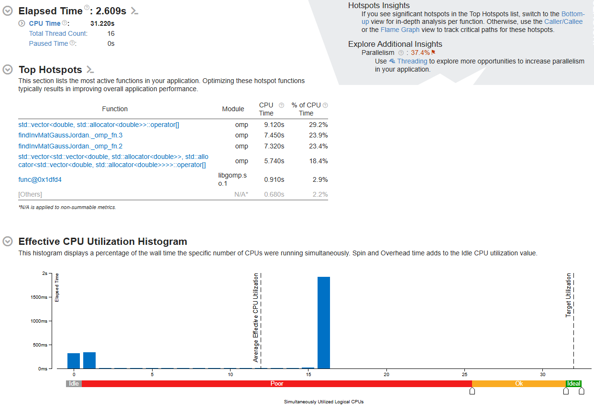
*Figure 7. OpenMP VTune profile, 16 cores.*

#### MPI

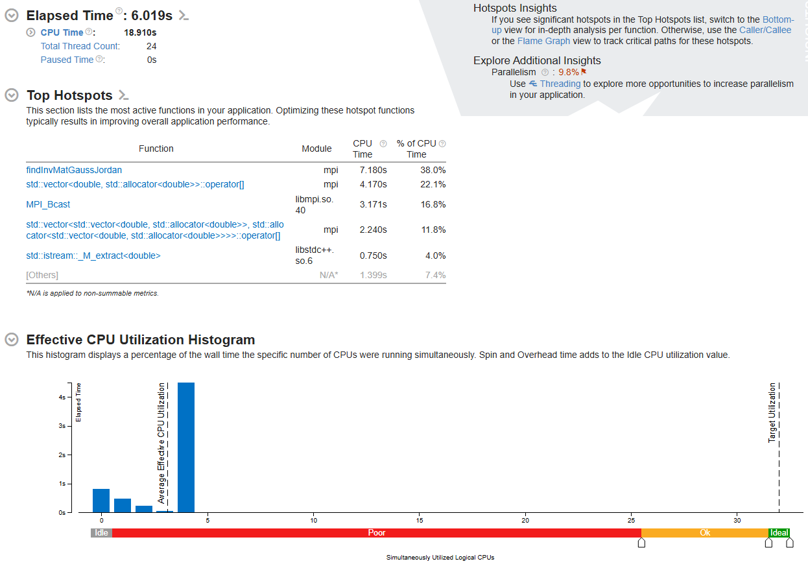
*Figure 8. MPI VTune profile, 4 processes.*

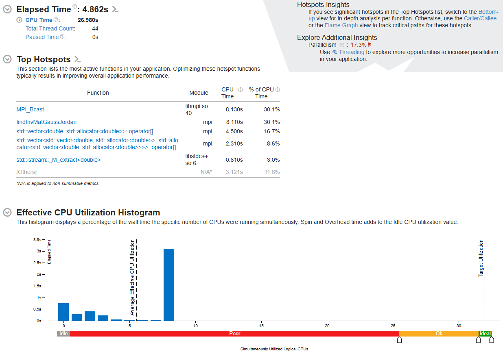
*Figure 9. MPI VTune profile, 8 processes.*

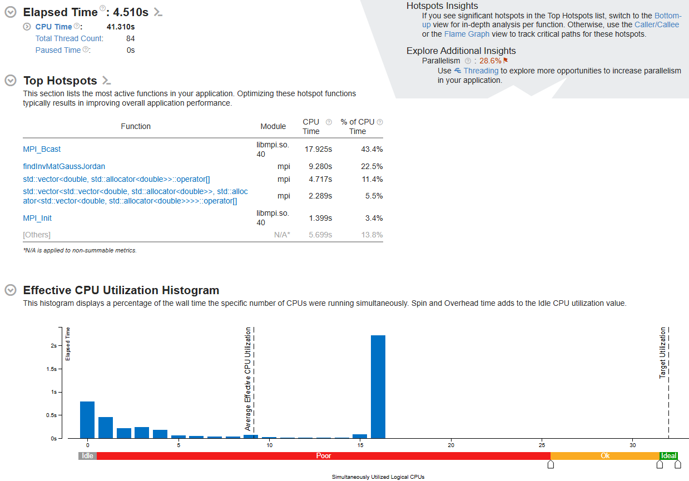
*Figure 10. MPI VTune profile, 16 processes.*

### Execution time for an 800×800 matrix

| Cores / processes | Pthreads | OpenMP | MPI | Sequential |
| ---: | ---: | ---: | ---: | ---: |
| 1 | — | — | — | 10.77 s |
| 4 | 5.73 s | 7.12 s | 6.01 s | — |
| 8 | 3.53 s | 4.21 s | 4.86 s | — |
| 16 | **2.21 s** | 2.61 s | 4.51 s | — |

### Speedup charts

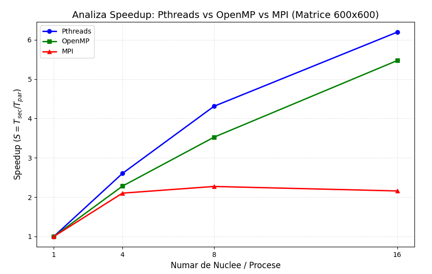
*Figure 11. Speedup for 600×600 matrices.*

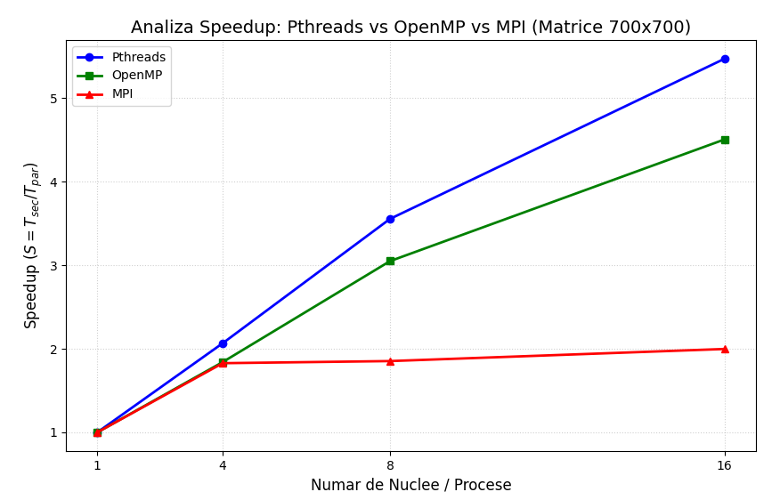
*Figure 12. Speedup for 700×700 matrices.*

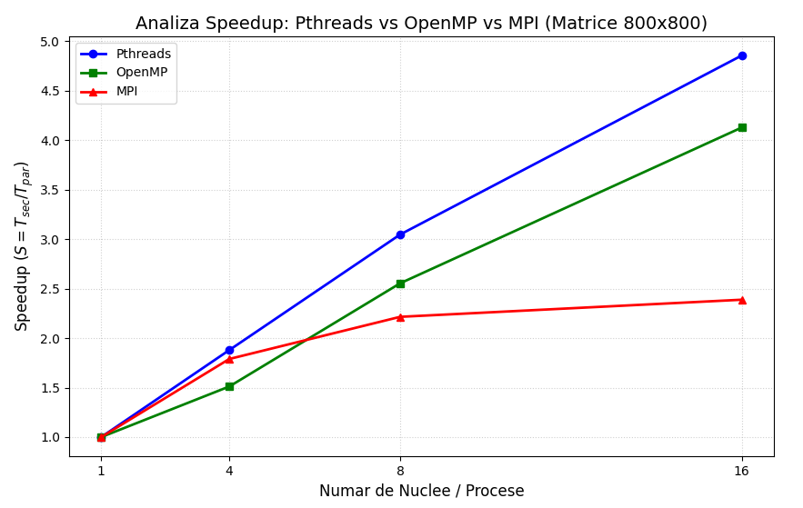
*Figure 13. Speedup for 800×800 matrices.*

### Interpretation by implementation

**Pthreads.** Pthreads achieved the lowest execution time across the tested parallel configurations for the 800×800 matrix: 5.73 s at 4 cores, 3.53 s at 8 cores, and 2.21 s at 16 cores. The increase from 4 to 8 cores corresponds to approximately **1.62× additional speedup**; against the 10.77 s sequential baseline, the 16-core run achieved approximately **4.86× speedup**.

**OpenMP.** OpenMP was the slowest parallel implementation at 4 cores (7.12 s for the 800×800 matrix). The repeated fork–join pattern likely contributed scheduling overhead, but the implementation scaled well as the core count increased, reaching 4.21 s at 8 cores and 2.61 s at 16 cores.

**MPI.** MPI performed comparatively well at 4 processes (6.01 s for 800×800), but scaling was limited by communication and synchronization overhead. Runtime decreased to 4.86 s at 8 processes and only 4.51 s at 16 processes, an improvement of approximately **7%** from 8 to 16.

### Execution time by matrix size

All times are in seconds. Dashes indicate configurations not measured in the original results.

| Matrix size | Cores / processes | Sequential | Pthreads | OpenMP | MPI |
| --- | ---: | ---: | ---: | ---: | ---: |
| 300×300 | 1 | 0.580 | — | — | — |
| | 4 | — | 0.635 | 0.715 | 1.860 |
| | 8 | — | 0.435 | 0.515 | 1.950 |
| | 16 | — | 0.235 | 0.315 | 2.050 |
| 500×500 | 1 | 2.610 | — | — | — |
| | 4 | — | 1.710 | 2.029 | 2.711 |
| | 8 | — | 1.010 | 1.320 | 2.910 |
| | 16 | — | 0.710 | 0.920 | 3.110 |
| 600×600 | 1 | 7.370 | — | — | — |
| | 4 | — | 2.831 | 3.232 | 3.506 |
| | 8 | — | 1.710 | 2.091 | 3.244 |
| | 16 | — | 1.190 | 1.347 | 3.415 |
| 700×700 | 1 | 9.010 | — | — | — |
| | 4 | — | 4.359 | 4.893 | 4.929 |
| | 8 | — | 2.535 | 2.955 | 4.862 |
| | 16 | — | 1.647 | 2.000 | 4.510 |
| 800×800 | 1 | 10.770 | — | — | — |
| | 4 | — | 5.731 | 7.126 | 6.019 |
| | 8 | — | 3.535 | 4.217 | 4.862 |
| | 16 | — | 2.218 | 2.609 | 4.510 |

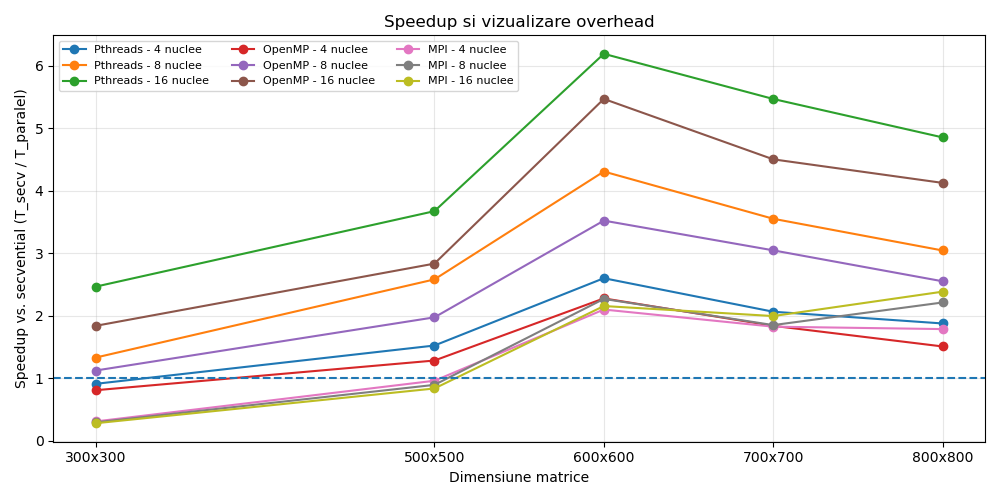
*Figure 14. Speedup comparison across matrix sizes and implementations.*

### Parallelization overhead and matrix size

For smaller matrices, such as 300×300, parallelization overhead can outweigh the computational savings. At 4 cores, Pthreads took 0.635 s and OpenMP took 0.715 s, both slower than the 0.580 s sequential run. MPI was considerably slower at 1.860 s, reflecting process and communication overhead.

For larger matrices, the **O(n³)** computational workload better amortizes the costs of thread scheduling and synchronization. At 600×600 with 16 cores, Pthreads achieved approximately **6.2× speedup** relative to sequential execution (7.370 s / 1.190 s), with OpenMP close behind at approximately **5.5×**. MPI remained more limited by its communication overhead.

The observed reduction in speedup efficiency at larger matrix sizes (such as 700×700 and 800×800) may be related to cache capacity, memory bandwidth, and synchronization costs. For MPI, exchanging pivot-row data adds further communication overhead. These are plausible explanations based on the measurements, rather than individually isolated causes.

## Conclusions

**Pthreads was the fastest parallel implementation in the reported experiments**, across all tested parallel core counts and matrix sizes. OpenMP also scaled effectively, while MPI offered smaller gains as the number of processes increased, particularly because of communication overhead.

The results show why the choice of parallel programming model matters: using more cores or processes does not automatically improve performance, especially when the workload is small relative to the cost of coordination.

## Contributors

- Ana-Maria Ailiesei
- Andreea-Denisa Olteanu

## Reference

- [Finding the Inverse of a Matrix Using Gauss–Jordan Method in C++ — TutorialsPoint](https://www.tutorialspoint.com/finding-inverse-of-a-matrix-using-gauss-jordan-method-in-cplusplus)
